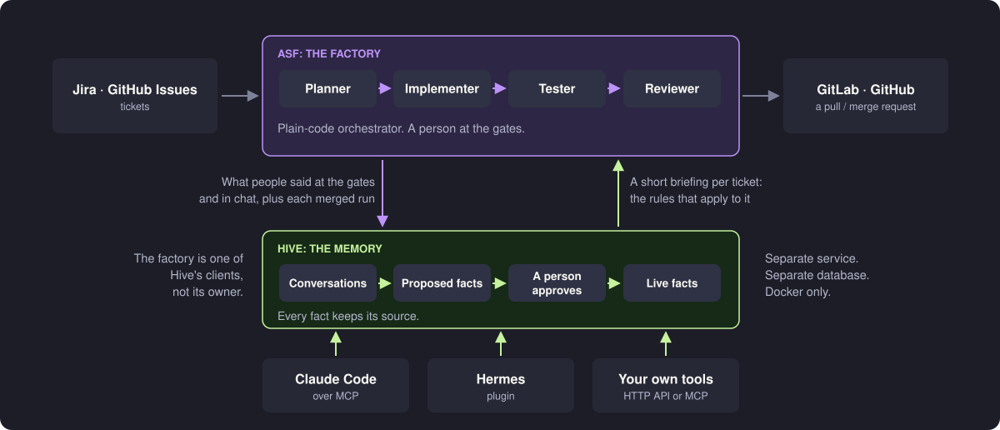

# Agentic Software Factory

[](https://github.com/bennybrau/agentic-software-factory/actions/workflows/ci.yml)
[](https://github.com/bennybrau/agentic-software-factory/actions/workflows/install-e2e.yml)
[](LICENSE)

**Turn tickets into pull requests with a small team of AI agents, and keep a person in charge.** Pick a ticket
from Jira, GitHub Issues or Trello. ASF (the factory) plans it, writes the code, tests it, reviews it, and opens a
pull or merge request. You approve each step you want to see.

> **Status:** pre-1.0 and moving fast. It's used daily, but settings and APIs can still change between minor
> versions. See [CHANGELOG.md](CHANGELOG.md).

## What we're trying to do

A coding agent in your terminal is great for one person and one task. It gets harder when you want agents to work
through a team's backlog:

- **Who's watching?** An agent left alone can wander off: wrong approach, wrong files, a merge nobody asked for.
- **Who checks the work?** The agent that wrote the code is a poor judge of it.
- **Where does it run?** On someone's laptop, with their credentials, while they wait.
- **What did it cost?** Nobody knows until the bill arrives.

ASF runs every ticket the same way, on a machine you control, with a separate agent for each job:

1. **Planner** reads the ticket and the code and writes a plan.
2. **Implementer** makes the change on a branch.
3. **Tester** runs and writes tests.
4. **Reviewer** checks the change with fresh eyes and can send it back to the implementer.
5. ASF pushes the branch and opens a pull/merge request.

Between steps are **gates**: a person approves, edits or rejects. You choose which gates stop and wait, which only
notify you, and which are skipped. The gate before merging stops by default.

The part that decides what happens next (the **orchestrator**) is plain TypeScript, not an AI model. Runs behave
the same way every time, and debug like normal software.

## Why would I use this?

- **Your backlog gets worked while you do other things.** Queue several tickets; they run in parallel in
  containers, not on your laptop.
- **You stay in control.** You see the plan before any code is written, and nothing merges without your approval
  (unless you explicitly turn that off).
- **The reviewer is independent.** Each role runs as a fresh process, so the reviewer didn't write the code it's
  reviewing.
- **Credentials stay safe.** Your tracker and code-host tokens never reach the agents or the browser.
- **Costs are capped.** Set a limit per ticket and per month; over the monthly budget, new runs are refused.
- **Use the tools you already have:** Jira, GitHub Issues, Trello or tickets typed in the UI; GitHub or GitLab; Claude
  Code (subscription, API key, Vertex AI, Bedrock), OpenAI Codex, OpenCode, GitHub Copilot CLI or local models
  through Ollama, chosen per role.

When you *don't* need it: if you only ever run one agent yourself, in your own terminal, a coding agent on its own
is simpler.

## How it fits with Hive

Agents start every ticket from zero: a correction you gave yesterday is gone today.
[Hive](https://github.com/bennybrau/hive) is a separate, optional service that fixes that. ASF sends Hive what
people said at the gates and in run chats, plus each merged run. Hive turns corrections into facts that a person
approves, and gives ASF a short briefing for every new ticket with the rules that apply to it. The planner cites
the facts it used, like `[hive:1a2b3c4d]`, so you can check them.



ASF works fine without Hive. Hive works without ASF too: Claude Code and Hermes connect to it directly.

### Words you'll see

| Word | Meaning |
|---|---|
| **Run** | One ticket going through the factory, from plan to pull request. |
| **Role** | One job in a run: planner, implementer, tester or reviewer. Each is its own agent process. |
| **Gate** | A checkpoint between steps. *Required* stops and waits for you, *notify* tells you and continues, *auto* skips. |
| **Worker** | The container that runs agents. It picks up one step at a time. |
| **Provider** | A connection to an outside service: your ticket tracker, your code host, or an agent runtime. |

## Set it up on a host machine

You need one machine that stays on: a desktop, a mini-PC, a server, or a Mac kept awake. Not your daily laptop: the
worker runs your repos' code and holds tracker tokens.

### 1. Install the prerequisites

- **Docker** with Compose v2: [Docker Desktop](https://www.docker.com/products/docker-desktop/) or
  [Rancher Desktop](https://rancherdesktop.io/) on a Mac, Docker Engine on Linux. Check: `docker compose version`.
- **git**. Check: `git --version`.
- **About 10 GB of free disk** for images and working copies of your repos.
- **An agent credential.** The simplest is an [Anthropic API key](https://console.anthropic.com/). A Claude
  subscription token (`claude setup-token`) also works for your own personal use; see
  [docs/CLAUDE_USAGE.md](docs/CLAUDE_USAGE.md) for which to pick.
- **A token for your tracker and code host**, for example a GitHub personal access token with repo access.

On a Mac, don't install into `~/Documents`, `~/Desktop` or `~/Downloads`: Docker can be denied access there.

### 2. Run the installer

```bash
curl -fsSL https://raw.githubusercontent.com/bennybrau/agentic-software-factory/main/scripts/install.sh | bash
```

It clones ASF into `~/asf` and runs `scripts/setup.sh`, which checks your machine, writes the settings file
(`.env`, with fresh secrets), builds and starts everything, and prints a URL. When it asks which **mode**, press
**Enter** for mode 1 (everything in containers).

Prefer to clone it yourself?

```bash
git clone https://github.com/bennybrau/agentic-software-factory.git ~/asf
cd ~/asf
./scripts/setup.sh
```

### 3. Finish in the browser

Open **http://localhost:8787**. A new factory starts at a short setup page, one question per screen:

1. **Where do your tickets live?** Pick GitHub, Jira, Trello or sample tickets, enter the details, and press
   **Save and check it works**.
2. **Where does your code live?** GitHub or GitLab (skipped when your tickets are on GitHub).
3. **Which AI should do the work?** Paste the agent credential from step 1.
4. **When should it check with you?** Pick a preset. The recommended one stops for you at the plan
   and before merge.
5. **How much can it spend?** A limit per ticket and per month.

The last screen waits for a worker to come online, then takes you to **Things to do**.

### 4. Run your first ticket

On **Things to do**, pick a small ticket and start it. Open the run to watch it live. When the plan is ready, read
it and approve it (or type a correction in the plan chat). A few minutes later you get a pull request link.

### 5. Optional: connect Hive

1. Install Hive (on the same machine is fine) by following
   [Hive's setup steps](https://github.com/bennybrau/hive#set-it-up-on-a-host-machine). When the installer asks for
   teammates' names, include `asf-factory`, and keep the token it prints for it.
2. In Hive's dashboard, go to **Repos → Add by URL** and add every repository ASF works on.
3. In ASF, open **Settings → Send finished work to Hive?** and enter:
   - Hive address: `http://host.docker.internal:8800` when Hive runs on the same machine, else Hive's network
     address.
   - Hive token: the `asf-factory` token.
   - Hive dashboard address: the address you open Hive's dashboard at, e.g. `http://127.0.0.1:8800`.

   No restart needed. On Linux (not Docker Desktop or Rancher Desktop), Hive must listen beyond `127.0.0.1` for
   ASF's containers to reach it: answer `0.0.0.0` to Hive's **Listen on** question.
4. Correct a plan in your own words. Within a few minutes the correction shows up in Hive's **Review** page.
   Approve it, and the next related ticket's plan lists it under **Team memory**.

What is sent and when: [docs/HIVE.md](docs/HIVE.md).

### Day to day

```bash
cd ~/asf
scripts/asf status     # what's running
scripts/asf doctor     # health check (✓/✗/⚠): start here when something's off
scripts/asf logs -f    # follow the logs
scripts/asf update     # pull the latest images and restart
scripts/asf backup     # back up the database now
```

Full install guide (modes, Vertex AI, reaching it from other machines with Tailscale): [docs/INSTALL.md](docs/INSTALL.md).
Upgrades and backups: [docs/UPGRADING.md](docs/UPGRADING.md).

## Learn more

- [docs/PIPELINE.md](docs/PIPELINE.md): the run lifecycle: roles, gates, the review loop, publishing.
- [docs/PROVIDERS.md](docs/PROVIDERS.md): trackers, code hosts and how to add one.
- [docs/RUNTIMES.md](docs/RUNTIMES.md): agent runtimes (Claude Code, Codex, OpenCode, Copilot CLI).
- [docs/OLLAMA.md](docs/OLLAMA.md): free models on your own machine or Ollama Cloud, mixed into a team.
- [docs/CONFIGURATION.md](docs/CONFIGURATION.md): every setting, generated from the code.
- [docs/SELF_HOSTING.md](docs/SELF_HOSTING.md): the containers, volumes and ports.
- [docs/HOSTING.md](docs/HOSTING.md): running it on GCP (Cloud Run + Cloud SQL + IAP + Vertex).

## For contributors

### How it's built

```
┌────────────┐  HTTP/SSE  ┌────────────────┐        ┌──────────────────────┐
│  apps/web  │◀──────────▶│   apps/api     │───────▶│ TicketProvider       │ jira | github | trello | adhoc
│ Today/Queue│            │ providers +    │───────▶│ ScmProvider          │ gitlab | github
│ Run/Team   │            │ notifications  │───────▶│ NotificationSink     │ web | telegram
└────────────┘            └───────┬────────┘        └──────────────────────┘
                                  │ RPC/SSE
                          ┌───────┴────────┐        ┌──────────────────────┐
                          │ apps/registry  │◀───────│  apps/worker (N)     │
                          │ runs, tasks,   │  claim │  one role task,      │
                          │ orchestrator,  │        │  one AgentRuntime,   │
                          │ Postgres       │        │  one process, exit   │
                          └────────────────┘        └──────────────────────┘
```

### Layout

```
packages/shared/      Zod schemas + the four provider interfaces. The contract everything imports.
  ticket.ts           Ticket, TicketProvider
  scm.ts              Repo, ChangeRequest, ScmProvider, FORBIDDEN_BRANCHES
  team.ts             Role, TeamTemplate, gates (required | notify | auto), STANDARD_TEAM
  run.ts              Run, RunTask, RunEvent, states
  runtime.ts          AgentRuntime, AgentSpawn, AgentOutcome
  notification.ts     NotificationSink
  settings.ts         Every decision as a named setting; .env.example + docs/CONFIGURATION.md generated from it
apps/api/             Fastify. Holds credentials. providers/tickets/*, providers/scm/*. No DB.
apps/registry/        Fastify + Postgres. Runs, tasks, gates, workers, orchestrator, sweeper, SSE fan-out.
apps/worker/          Claims a task, runs a role via runtimes/*, reports events, exits.
apps/web/             Vite + React. Today, Things to do (backlog), Work history (runs), Settings.
prompts/roles/        planner.md, implementer.md, tester.md, reviewer.md — shipped here, not discovered from a laptop.
db/migrations/        Additive SQL, applied by the registry.
docs/plan.md          Architecture & extraction plan (the why).
docs/IMPLEMENTATION_PLAN.md  Milestones, work packages, done-when (the how).
```

### Rules that must stay true

- No credential reaches the browser; no ticket/SCM credential reaches the registry or an agent.
- Only the registry connects to Postgres.
- The orchestrator is plain TypeScript. An LLM never decides what a state becomes.
- One task = one process; nothing is held across a gate.
- Gates are configurable, but `before_merge` defaults to `required` and can only be relaxed by an explicit, visible project-level setting.
- Refuse with a reason rather than guess. Never push to a forbidden branch.
- Providers are loaded from one factory each (`providers/*/index.ts`, `runtimes/index.ts`); nothing else imports a concrete provider.
- Every decision is a named setting in `packages/shared/src/settings.ts`, resolved env > org (UI) > default; `.env.example` and `docs/CONFIGURATION.md` are generated from it and CI fails if they drift.

### Developing

Needs Node 22+ and pnpm.

```bash
pnpm install
pnpm --filter @asf/shared build
cp .env.example .env
pnpm db:up                     # Postgres in Docker (role asf/asf, databases asf + asf_test)
pnpm test                      # registry tests need DATABASE_TEST_URL (default asf_test); they skip without it
pnpm dev                       # registry :8788 -> api :8787 -> one worker, waited on in turn (node scripts/dev.mjs)
pnpm dev:mock                  # registry + api only, no agent spend (--no-worker)
pnpm dev:web                   # :3999
```

Regenerate `.env.example` and `docs/CONFIGURATION.md` after editing the settings catalogue with `pnpm gen:config`
(CI runs `pnpm gen:config:check`).

### Roadmap

[`docs/IMPLEMENTATION_PLAN.md`](docs/IMPLEMENTATION_PLAN.md) records how it was built, milestone by milestone. Open work is tracked in [issues](https://github.com/bennybrau/agentic-software-factory/issues) and [milestones](https://github.com/bennybrau/agentic-software-factory/milestones).

## Contributing

Contributions are welcome: bug reports, docs, new ticket/SCM providers, new agent runtimes. Start with [CONTRIBUTING.md](CONTRIBUTING.md). Report security issues privately per [SECURITY.md](SECURITY.md). Everyone taking part follows the [Code of Conduct](CODE_OF_CONDUCT.md).

## License

[MIT](LICENSE) © 2026 Jon Arme. Third-party notices are in [NOTICE](NOTICE). The worker image installs the Claude Code and Codex CLIs, which have their own terms. You bring your own agent account or API key. See [Using Claude responsibly](docs/CLAUDE_USAGE.md).
